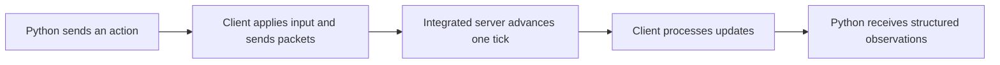

# MinecraftRL

MinecraftRL is a reinforcement learning environment for Minecraft Java Edition 1.8.9. A Python agent learns to aim, choose tools, bridge across the void, or break through a bed defense by controlling a real Forge client. Each action advances the integrated server by one tick before Python receives the next observation.

## Tasks

| Task | What the policy learns |
| --- | --- |
| `aim_break_tnt` | Turn toward a TNT block and break it. |
| `multi_tool_break` | Aim, pick the right tool, and break several targets with different materials. |
| `bridging` | Place blocks at the edge of a platform and cross a gap. Training starts with a one-block gap and progresses to variable lengths. |
| `bed_defense_break_v2` | Find a route through layered materials, select tools, and reach the bed. Observations express the defense relative to the bed so the layout can rotate. |

An earlier parkour experiment failed to learn a reliable policy. The included `pvp_benchmark` task exercises the reset and combat paths against a scripted zombie for systems measurements.

## How a step works

Each task defines its Gymnasium action and observation spaces, rewards, and reset rules. The Forge mod builds and resets arenas, then sends only the fields requested by the task over newline-delimited JSON on loopback TCP. HeadlessMC gives each client its own world and port. Stable-Baselines3 trains PPO across those independent environments.

## Training throughput

In a paired Bed Defense V2 benchmark, **PPO training with ten local clients processed 84% more transitions per second** after two changes. The renderless Java clients waited for new actions between steps, freeing CPU time for the trainer. Lightweight Python workers shared observation buffers without loading PyTorch in every process.

| Metric | Shared workers, idle polling | Lightweight workers, event wait |
| --- | ---: | ---: |
| Median warmed transitions/s, including PPO updates | 632 | **1,164** |
| Maximum summed process RSS across runs | 16.67 GiB | **11.26 GiB** |
| Median p95 vector-step latency | 20.27 ms | **13.00 ms** |

Three paired seeds, CPU policy, 1 GiB maximum Java heap per client, and 25,600 transitions per run. Timing begins after warm-up and ends before final checkpoint save. See the [benchmark report](RLCraft/benchmarks/optimization_summary.md) for the per-change measurements and the run that stopped at the system-memory limit.

## Run it

Start with one client on Windows. The [setup guide](docs/setup.md) covers the Java and Python prerequisites, building the Forge mod, running a smoke test, and training and evaluating your first PPO policy.

- [Task and protocol reference](RLCraft/README.md)
- [HeadlessMC launcher notes](HeadlessMC/README.md)

## Project credits

AngelFireLA designed the RL tasks, including their actions, observations, rewards, and curricula. AI coding agents generated the Java/Python bridge and training implementation.

MinecraftRL is an independent project unaffiliated with Mojang or Microsoft. [Third-party notices](THIRD_PARTY_NOTICES.md)

## License

The original MinecraftRL materials are available under the MIT License with the Commons Clause 1.0. You can use, modify, and share the project under those terms. The Commons Clause restricts selling MinecraftRL or charging for a product or service that derives substantial value from its functionality. [Project license](LICENSE)
